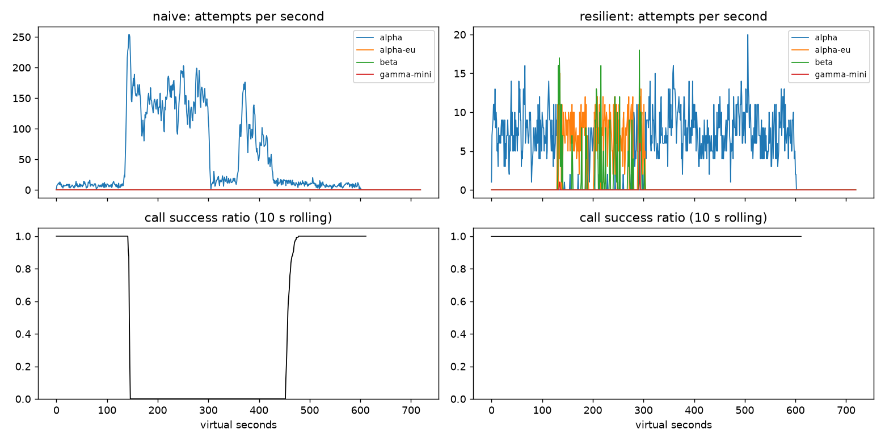

# Lab 25B — Report

**Họ tên / nhóm:** [Tự điền]  **MSV:** [Tự điền]

**Commit:** `f5ddeb7` (mốc mã nguồn A–E/G đã hoàn thiện; báo cáo và kiểm tra được commit tiếp sau).

**Điểm tự động:** **84 / 88** trên dữ liệu public. Còn 4 điểm SLO ẩn do giảng viên chấm; 12 điểm báo cáo chưa được chấm tay. Không suy ra 100 điểm từ kết quả local.

Các bảng chính dùng simulator seed **25**, client seed **1**. Kết quả nhiều seed được ghi riêng, không trộn giữa các hàng. Mốc nguồn: `reports/gameday/`, `part_d_runs/run_001/`, `part_e_runs/run_001/`, `part_f_runs/run_001/`, `part_g_runs/run_001/`. Các giá trị thập phân trong bảng giữ dấu chấm như JSON để dễ đối chiếu.

## 1. Kết quả Game Day: naive và resilient

| Băng | Client | Availability | p95 (s) | Amplification | Retry ratio | Cost/good turn | Recovery (s) | PASS |
|---|---|---:|---:|---:|---:|---:|---:|---|
| G1 | naive | 0.7194 | 7.157 | 7.738 | 6.738 | 2.163 | 4 | Không |
| G1 | resilient | 1.0000 | 4.738 | 1.063 | 0.002 | 2.106 | 0 | Có |
| G2 | naive | 0.4560 | 15.034 | 9.904 | 8.904 | 4.627 | 155 | Không |
| G2 | resilient | 1.0000 | 8.896 | 1.046 | 0.009 | 2.133 | 0 | Có |
| G3 | naive | 1.0000 | 4.768 | 1.164 | 0.164 | 2.328 | 0 | Không |
| G3 | resilient | 1.0000 | 4.569 | 1.083 | 0.049 | 2.177 | 0 | Có |
| G4 | naive | 1.0000 | 13.764 | 1.004 | 0.004 | 2.008 | 0 | Không |
| G4 | resilient | 1.0000 | 5.604 | 1.029 | 0.004 | 2.101 | 0 | Có |
| G5 | naive | 0.3699 | 5.359 | 17.030 | 16.030 | 2.124 | — | Không |
| G5 | resilient | 0.8179 | 5.477 | 1.003 | 0.003 | 2.504 | — | Có |
| G6 | naive | 0.5170 | 4.836 | 12.344 | 11.344 | 2.009 | 0 | Không |
| G6 | resilient | 0.9996 | 5.982 | 1.058 | 0.022 | 2.208 | 0 | Có |

Nguồn: `gameday/naive.json`, `gameday/resilient.json`; đối chứng F tái chạy resilient và khớp số trên. Resilient PASS cả 6 băng trên từng seed 25, 26, 27. Trong seed 25, retry-after violations, client-error retries, incompatible routes và unneeded failovers đều bằng 0. Primary share sau phục hồi ở G2/G4/G6 bằng 1.000. Dấu — ở G5 là không có mốc restore trong kịch bản, không phải recovery bằng 0.

## 2. Cấu hình client và lý do

| Tham số | Giá trị | Lý do và bằng chứng |
|---|---:|---|
| attempt_timeout_s | 6 | G2 p95 giảm từ 10.362 (timeout 8) xuống 8.896; G6 availability 0.9996, cao hơn 0.9484 khi timeout 30 |
| max_attempts_per_provider | 2 | Tối đa một retry/provider; G2 amplification 1.046, G3 retry ratio 0.049 |
| min_time_left_s | 1 | Không cấp attempt khi còn quá ít deadline; G6 mặc định không có `deadline` give-up |
| backoff_base_s / cap_s | 0.25 / 4 | Full jitter cho retry cùng provider; G3 retry ratio 0.049 và amplification 1.083, failover không chờ backoff cũ |
| retry_budget_ratio | 0.1 | Khi breaker bị vô hiệu, G2 retry ratio 0.060 với budget so với 0.442 khi tắt budget |
| retry_budget_min_per_s / max_tokens | 0.5 / 20 | Cho một lượng retry khi ít traffic và burst nhỏ; ratio không phải giới hạn cứng 10% vì còn refill theo thời gian |
| quota_cooldown_s | 300 | G5 không retry 400, không failover vô ích trong bad deploy; availability đạt 0.8179 dù tài khoản A hết quota |
| breaker.window_size / min_calls | 20 / 10 | Bỏ kết quả cũ và cần đủ mẫu; G2 recovery 0 thay cho 155 của naive |
| breaker.failure_rate_threshold | 0.5 | Bắt lỗi provider; kết hợp budget giữ G3 retry ratio 0.049 ≤ 0.10 |
| breaker.slow_call_s / slow_rate_threshold | 5 / 0.6 | G4 có thể mở breaker vì chậm dù request thành công; p95 5.604 ≤ 10 |
| breaker.open_duration_s | 10 | Có khoảng nghỉ trước probe; G2/G4/G6 đạt primary share 1.000 sau phục hồi |
| breaker.half_open_max_probes / half_open_successes | 2 / 2 | Giới hạn request đang bay khi phục hồi; đủ hai probe nhanh mới đóng, test đồng thời và stale generation đều pass |

Các số là kết quả của cả cấu hình, không khẳng định từng tham số riêng lẻ gây ra toàn bộ thay đổi. Việc giảm timeout 8 → 6 đã có đối chứng riêng trong `PART_C.md`; các sensitivity test mới nằm trong mục 3.

| Loại lỗi | Ghi breaker? | Retry cùng provider? | Failover/cooldown |
|---|---|---|---|
| CLIENT_ERROR: 400/401/403… | Không, trả permit | Không | GiveUp ngay; malformed request không được cứu bằng đổi provider |
| QUOTA_EXHAUSTED | Không, trả permit | Không | Cooldown 300 giây; chuyển provider ngay |
| RATE_LIMITED | Không, trả permit | Chỉ nếu phải quay lại sau cooldown ngắn, còn budget/attempt/deadline | Cooldown dùng chung ít nhất `retry_after`; ưu tiên chuyển provider ngay |
| OVERLOADED / SERVER_ERROR / TIMEOUT | Có | Khi breaker cho phép, còn attempt, token và deadline; chờ full jitter | Nếu không retry được thì chuyển provider ngay |

Tool call chỉ đi provider hỗ trợ tool. Khi mọi provider không dùng ngay được, chỉ chờ rate-limit cooldown tối đa 5 giây, không chờ quota. Mọi kết quả gửi breaker kèm permit/generation; callback đến muộn không làm đảo trạng thái mới. Cache là bậc cuối sau khi inner client bỏ cuộc, xem mục 8.

## 3. Ba thí nghiệm về client

Nguồn cố định: `part_f_runs/run_001/summary.csv`, settings/metric/timeseries từng thí nghiệm. Chỉ dùng seed 25 để so sánh các đối chứng tại mục này.

### 3.1. Retry budget là lớp phòng thủ cuối

Tất cả các hàng dưới đặt `max_attempts_per_provider = 5`. Nhánh breaker lỗi đặt `min_calls = 1000000000`; nhánh budget tắt đặt ratio 100, max tokens 1e9, refill 1e6/s.

| Breaker | Budget | Băng | Availability | Amplification | Retry ratio | Recovery (s) | p95 (s) |
|---|---|---|---:|---:|---:|---:|---:|
| Vô hiệu | Bật | G2 | 1.0000 | 1.400 | 0.060 | 0 | 15.621 |
| Vô hiệu | Tắt | G2 | 0.9729 | 1.672 | 0.442 | 42 | 18.527 |
| Vô hiệu | Bật | G3 | 1.0000 | 1.136 | 0.068 | 0 | 4.550 |
| Vô hiệu | Tắt | G3 | 1.0000 | 1.162 | 0.158 | 0 | 4.661 |
| Hoạt động | Bật | G2 | 1.0000 | 1.039 | 0.007 | 0 | 6.191 |
| Hoạt động | Tắt | G2 | 1.0000 | 1.039 | 0.007 | 0 | 6.191 |
| Hoạt động | Bật | G3 | 1.0000 | 1.034 | 0.020 | 0 | 4.754 |
| Hoạt động | Tắt | G3 | 1.0000 | 1.034 | 0.020 | 0 | 4.754 |

Khi breaker không mở, budget giảm retry cùng provider trên G2 từ 0.442 xuống 0.060 và recovery từ 42 xuống 0 giây; nhánh không budget có 64 lần GiveUp vì deadline. Khi breaker hoạt động đúng, hai nhánh budget cho số giống nhau trong thí nghiệm này vì breaker đã chặn tải xấu trước khi budget trở thành giới hạn. Vẫn cần cả hai: breaker bảo vệ từng provider dựa trên mẫu sức khỏe, còn budget chặn tổng lượng retry khi cửa sổ chưa đủ mẫu, ngưỡng bị cấu hình sai hoặc nhiều provider đồng thời lỗi. Các số này không chứng minh budget luôn cải thiện latency khi breaker đã hoạt động tốt.

### 3.2. Timeout 30 giây: xem availability trước p95

| Băng | Timeout | Availability | Good/total turns | Give-up reasons | p95 lượt thành công (s) |
|---|---:|---:|---:|---|---:|
| G4 | 6 | 1.0000 | 2174/2174 | Không | 5.604 |
| G4 | 30 | 1.0000 | 2174/2174 | Không | 5.608 |
| G6 | 6 | 0.9996 | 2384/2385 | no_provider_available: 1 | 5.982 |
| G6 | 30 | 0.9484 | 2262/2385 | deadline: 106; no_provider_available: 17 | 5.338 |

G4 là đối chứng chậm nhưng trả lời: tăng timeout hầu như không đổi p95 vì slow-call breaker vẫn hoạt động. G6 có region treo: timeout 30 tiêu gần hết deadline của lượt trước khi kịp fallback, làm thất bại thêm 122 lượt. p95 lại thấp hơn vì simulator chỉ tính lượt thành công; các lượt chậm rồi chết không còn nằm trong mẫu latency. Timeout nên dựa trên phân bố latency khỏe, deadline còn lại của cả workflow và thời gian cần cho fallback; không lấy 30 giây chờ của user làm timeout cho mỗi attempt.

### 3.3. Bỏ lọc tool calling

| G6 | Availability | Incompatible routes | Give-up vì output không tương thích |
|---|---:|---:|---:|
| Có lọc khả năng | 0.9996 | 0 | 0 |
| Không lọc | 0.8948 | 251 | 251 |

Model nhỏ trả lời nhanh và rẻ nhưng không thực hiện được bước chọn tool. Bỏ bộ lọc làm 251 lượt nhận output không thể dùng để hoàn tiền, availability giảm khoảng 10.48 điểm phần trăm. Đổi model chỉ hữu ích khi model đích đáp ứng tính năng của bước đang chạy; đây là điều kiện chức năng của sản phẩm, không chỉ là tối ưu chi phí. Client production giữ bộ lọc; biến thể sai chỉ tồn tại trong script thí nghiệm.

## 4. Workflow hoàn tiền

Nguồn: `workflows.json` và mốc `part_d_runs/run_001/seed_25.json`.

| Executor | Completion | Crashes | Refund trùng | Email trùng | Refund mất | Overpaid (cent) | Wasted LLM/crash |
|---|---:|---:|---:|---:|---:|---:|---:|
| naive | 1.0000 | 81 | 128 | 81 | 0 | 1574200 | 1.123 |
| yours | 1.0000 | 66 | 0 | 0 | 0 | 0 | 0.303 |

Mỗi seed có 500 workflow. Seed 26/27 cũng completion 1.0000, không refund/email trùng hoặc refund mất; wasted LLM/crash lần lượt 0.241/0.338, đều ≤0.6.

Idempotency key ổn định theo session/step giữ cho payment/email chỉ có một effect kể cả response mất hoặc worker chết ngay sau commit. Chỉ key chưa đủ vì worker vẫn tính lại LLM/read nếu không có checkpoint. Chỉ checkpoint chưa đủ vì có khoảng trống giữa side effect thành công và lưu checkpoint: restart sẽ gọi payment lại. Ghi checkpoint trước payment còn nguy hiểm hơn vì worker sau có thể bỏ qua một refund chưa thực hiện. Executor chỉ checkpoint sau thành công, retry cùng key và để `WorkerCrash` thoát ra cho runner khởi động worker mới.

## 5. Alerting và error budget

Nguồn: `slo.json`, mốc `part_e_runs/run_001/`. Dữ liệu có 43.200 phút; SLO 99.5%/30 ngày.

| Sự cố | Mong đợi | Naive alerter | Burn-rate alerter | Delay burn-rate (phút) |
|---|---|---|---|---:|
| checkout_bug | page | page sau 1 phút | page | 27 |
| provider_outage | page | page ngay | page | 4 |
| deploy_blip | none | page sai | không page | — |
| slow_leak | ticket | không ticket | ticket, không page | 1337 |
| degraded_evening | page | page sau 214 phút | page | 291 |
| night_spike | none | page sai | không page | — |
| small_bump | none | page sai | không page | — |

Naive: 7 page, 0 ticket, 3 false page. Burn-rate: 3 page, 1 ticket, 0 false page, đạt mọi thời hạn của dữ liệu public. Prefix sums cho truy vấn O(1); chỉ firing khi cả cửa sổ dài và ngắn đạt ngưỡng, mỗi episode phát một event thay vì một event/phút.

Tổng request 25,901,755; bad 55,618; allowed bad 129,508.8. Availability 99.7853%; budget đã dùng **42.95%**, còn **57.05%**; **không freeze release** theo luật của bài. `small_bump` có 1,794 bad request, dùng khoảng 1.385% budget tháng; burn 1h cao nhất 8.225× (<14.4×), burn 6h cao nhất 1.911× (<6×) trong sự cố và 60 phút sau. Nó không đạt ngưỡng page dù 5-minute error ratio vượt 5%; việc tự hồi phục của một bump nhỏ không nên đánh thức on-call chỉ vì ngưỡng ngắn hạn cố định bị vượt.

## 6. Postmortem: G2 với client naive, blameless



**Tóm tắt (3 câu).** Tại t=120, alpha mất 75% năng lực trong 180 giây, làm hàng đợi tăng và request bắt đầu timeout. Retry ba tầng của v1 tiếp tục tạo tải lớn, còn request đã timeout vẫn chiếm công suất phía server. Provider hồi phục ở t=300 nhưng hệ thống chỉ đạt lại ngưỡng recovery ở t=455; client resilient giữ availability 100% trên cùng băng nhờ breaker, budget và fallback.

**Ảnh hưởng.** Có **1,285/2,362 lượt user thất bại** (54.40%), p95 của lượt thành công 15.034 giây. Recovery cần thêm **155 giây** sau lúc provider phục hồi, tức 335 giây kể từ trigger. CSV ghi nhận call failure từ giây 142 đến 468; đây là khoảng có kết quả call lỗi, không phải khẳng định mọi user đều thất bại suốt khoảng đó. Với giả định riêng cho postmortem là 4 lượt/s đều trong 30 ngày và SLO 99.5%, tháng có 10,368,000 lượt, budget 51,840 lượt xấu; riêng 1,285 lượt mất ở G2 tiêu **2.479%** budget tháng. Nếu tháng chỉ có sự cố này thì còn 97.521%; không trộn giả định này với budget của dataset SLI ở mục 5.

**Timeline.** Khoảng `[start, end)` dùng giây ảo; attempts/s là trung bình trong khoảng; success ratio ở đây đo logical call hoàn tất, khác availability theo lượt user.

| Khoảng t | Sự kiện | Attempts alpha/s | Call tốt / hoàn tất | Call success |
|---|---|---:|---:|---:|
| [100,120) | Trước sự cố | 8.15 | 160/160 | 100% |
| [120,140) | Mất GPU; tải retry bắt đầu tăng | 29.05 | 51/51 | 100% |
| [150,170) | Retry storm đã hình thành | 155.75 | 0/93 | 0% |
| [280,300) | Provider vẫn suy giảm | 154.85 | 0/83 | 0% |
| [300,320) | GPU hồi phục nhưng backlog còn | 27.25 | 0/28 | 0% |
| [400,420) | Tải retry tiếp tục duy trì lỗi sau restore | 74.25 | 0/77 | 0% |
| [455,485) | Cửa sổ 30 giây đầu đạt ≥95% call tốt | 10.87 | 352/368 | 95.65% |
| [500,520) | Trở về gần tải nền | 9.00 | 186/186 | 100% |

Nguồn phép tính: `part_f_runs/run_001/postmortem_G2.json`, CSV `gameday/naive_G2_overload_storm_timeseries.csv`. Việc call success còn 100% trong 20 giây đầu không phủ nhận sự cố: request đang xếp hàng chưa hoàn tất nên chưa nằm trong mẫu.

**Trigger và root cause.** Trigger là alpha mất 75% công suất. Root cause phía client là retry app × gateway × SDK tối đa 36 attempt/call, delay cố định, không budget/breaker/fallback. Timeout không hủy công việc server; retry tạo request mới trong khi request cũ vẫn chạy, backlog làm latency tăng, latency lại gây thêm timeout và retry. Vòng lặp này duy trì tải quá mức sau khi GPU đã trở lại: đây là metastable failure, không phải provider vẫn thiếu GPU ở t=400.

**Điều giúp và điều làm tệ hơn.** Các giới hạn cuối cùng về attempt/deadline giúp vòng lặp kết thúc khi tải cũ cạn đi, nhưng trước đó retry khuếch đại thành 34,475 attempt cho 3,481 logical call và 28,381 vi phạm retry-after. Resilient giới hạn retry, ngừng gửi vào provider yếu và chuyển sang vùng/provider khác; amplification còn 1.046 và cost/good turn giảm từ 4.627 xuống 2.133. Đây là vấn đề thiết kế tương tác giữa nhiều lớp, không quy trách nhiệm cho một cá nhân on-call.

| # | Action item | Loại | Owner theo vai trò | Cách kiểm chứng |
|---|---|---|---|---|
| 1 | Giữ retry ở một lớp, có full jitter, budget và tôn trọng retry-after | prevent | Nhóm client SDK | G1/G2 amplification ≤1.6, 0 retry-after violations trên nhiều seed |
| 2 | Dùng sliding-window breaker, bắt slow call, giới hạn HALF_OPEN probe | mitigate | Nhóm nền tảng agent | G2 recovery ≤30s; G4 p95 ≤10s; kiểm tra stale generation và probe cap |
| 3 | Theo dõi attempt/logical-call, provider timeout, trạng thái breaker và burn-rate | detect | Nhóm SRE | Không false page trên blip; mọi labelled page/ticket đúng thời hạn |
| 4 | Kiểm thử crash sau payment/email trước khi rollout | prevent | Nhóm workflow/QA | 500 workflow/seed, duplicate/lost effect =0, completion ≥99% |

Owner được ghi theo vai trò, chưa gán thông tin cá nhân. Các action về mã đã có trong bài; phần đưa vào CI/monitoring production là đề xuất tiếp theo, không tuyên bố đã triển khai ra hệ thống thật.

## 7. Điểm yếu còn lại

G2 vẫn có tail latency: seed 26 p95 **10.626 giây**, dù availability 100% và mọi check G2 PASS. Fallback sang beta cũng đắt hơn mỗi call (1.4 so với 1.0 của alpha); G6 cost/good turn 2.208. Có thể tiếp tục thử ngưỡng slow-call, admission control và định tuyến theo tải quan sát được để giảm tail/cost, nhưng phải đo nhiều seed và giữ yêu cầu tương thích tool/deadline. Không chọn cấu hình max-attempts 5 chỉ vì G2 seed 25 của một thí nghiệm đẹp hơn; cần kiểm chứng toàn bộ băng trước khi đổi cấu hình cuối.

Nếu mọi provider sập lâu hơn stale window, câu mới và câu cá nhân vẫn không trả lời được. Cần luồng báo trạng thái/chuyển người xử lý hoặc xử lý bất đồng bộ phù hợp; cache không thay thế khả năng truy vấn dữ liệu cá nhân còn đúng.

## 8. Cache: Part G

Nguồn chốt: `part_g_runs/run_001/`, không ghi đè bởi các lượt chạy mới. Kết quả thường nằm thêm ở `reports/cache/`.

| Client | Availability | FAQ availability | Cache hit | Stale served | Wrong | Outdated | Cost/good turn | PASS C1 |
|---|---:|---:|---:|---:|---:|---:|---:|---|
| Resilient, không cache | 0.8373 | 0.8424 | 0.000 | 0 | 0 | 0 | 1.386 | Không |
| Cached, cấu hình chốt | 0.9124 | 0.9645 | 0.592 | 192 | 0 | 2 | 0.955 | Có |

| Cache setting | Giá trị | Lý do |
|---|---:|---|
| similarity_threshold | 0.90 | Wrong =0; ngưỡng 0.80 có 181 other-question hit, 0.97 chỉ hit 0.499 ở seed 25 |
| ttl_s | 30 | Giới hạn tuổi answer được serve trực tiếp; outdated 2/4/7 trên ba seed, đều ≤15 |
| max_stale_s | 300 | Cứu 192 stale hit ở seed 25; tắt stale làm FAQ availability giảm 0.9645 → 0.8529 |
| max_entries | 500 | Có giới hạn dung lượng bằng LRU; eviction được test riêng, không tăng vô hạn theo traffic |

### 8.1. Thí nghiệm ngưỡng

Giữ TTL 30, stale 300. Với ngưỡng 0.80/0.90/0.97, hit ratio lần lượt **0.610/0.592/0.499**, wrong **181/0/0**, cost/good turn **1.016/0.955/1.018**. Ngưỡng thấp nhận cả câu khác ý; ngưỡng quá cao bỏ lỡ paraphrase đúng. Diagnostic ở `part_f_runs/run_001/cache_threshold_080_diagnostic/` ghi lại từng hit sai và khớp tổng 181 của simulator: refund_policy ↔ refund_time **77**, phí ship nội thành ↔ đi tỉnh **81**, payment_methods ↔ COD **13**, đổi size ↔ đổi màu **10**. Đây là số quan sát thực, không chỉ suy đoán từ độ gần embedding.

### 8.2. Thí nghiệm TTL

Giữ threshold 0.90, stale 300. TTL 30/60/300 cho hit ratio **0.592/0.652/0.731**, outdated **2/3/95**, cost/good turn **0.955/0.915/0.863** ở seed 25. TTL 60 cũng PASS trên cả ba seed; chọn 30 vì ưu tiên độ tươi và vẫn có dư địa so với hit tối thiểu 50%, không khẳng định số outdated luôn đơn điệu theo TTL. Webhook chỉ xử lý thay đổi được thông báo; thay đổi phí ship im lặng ở t=480 không có callback, nên TTL phải buộc refresh khi provider khỏe.

### 8.3. Thí nghiệm stale-if-error

Giữ threshold 0.90, TTL 30. Tắt stale làm FAQ availability **0.9645 → 0.8529**, hit **0.592 → 0.481**, stale served **192 → 0**; bật stale giúp vượt qua outage 120 giây. Entry chỉ stale sau TTL và chỉ serve sau khi inner client GiveUp; webhook và prompt scope vẫn có hiệu lực. Nếu tài liệu đổi im lặng trong outage, answer stale có thể cũ đến hết cửa sổ 330 giây tổng tuổi; đây là đánh đổi cần công khai với sản phẩm.

Seed 26/27: FAQ availability **0.9540/0.9627**, hit **0.591/0.591**, wrong **0/0**, outdated **4/7**; cả hai PASS. Không cache câu cá nhân dù tách user vì trạng thái đơn/tiền/điểm có thể thay đổi; tách user chỉ tránh lẫn người, không đảm bảo độ tươi. Dashboard availability có thể vẫn xanh nhờ cache, nên cần theo dõi provider error/timeout, breaker OPEN, tỷ lệ stale served và tuổi answer độc lập với tỷ lệ câu trả lời cuối thành công.

## Tái chạy và thông tin cần tự điền

Điền họ tên/nhóm và MSV ở đầu file. Tên repo/link nộp bài và việc push do chủ repo xác nhận sau khi bổ sung thông tin cá nhân; các lệnh dưới chỉ kiểm chứng local.

```powershell
python -m pytest -q -p no:cacheprovider
python scripts/grade.py --seeds 25,26,27
python scripts/run_report_experiments.py
```

Script thí nghiệm luôn tạo thư mục lượt mới và từ chối `--out` đã tồn tại. Không chạy `make clean` sau khi chuẩn bị artifacts vì nó xóa hình/CSV/kết quả. Mốc kiểm tra cuối và phạm vi điểm public được ghi trong `reports/VERIFICATION.md` ở bước 10.
